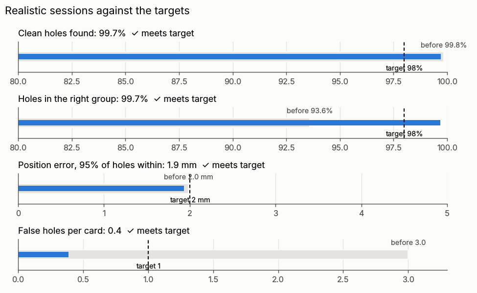
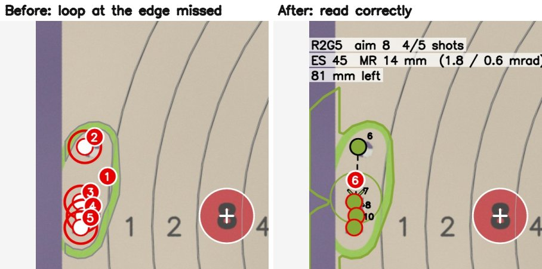
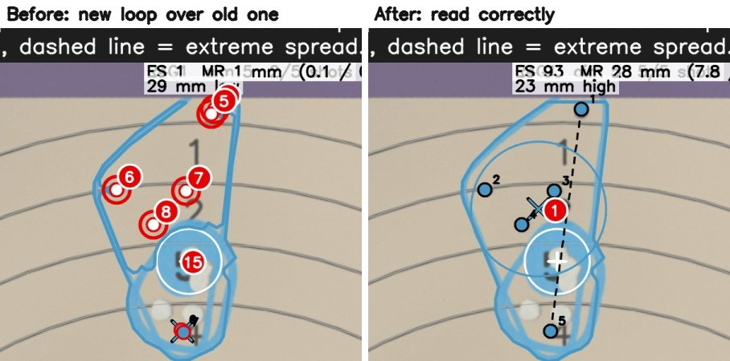
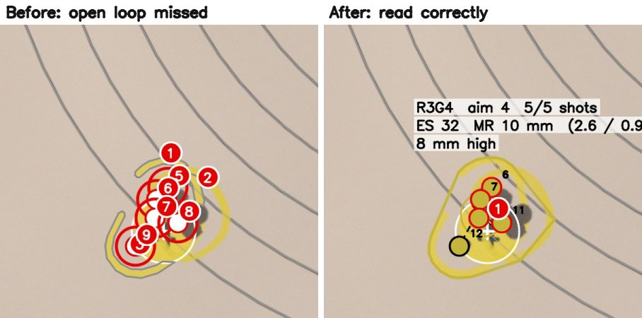
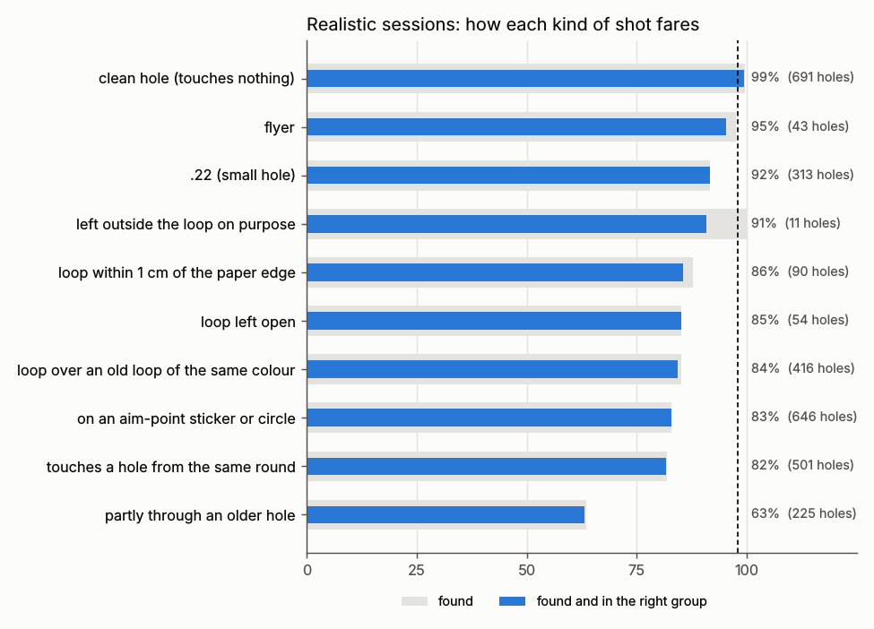
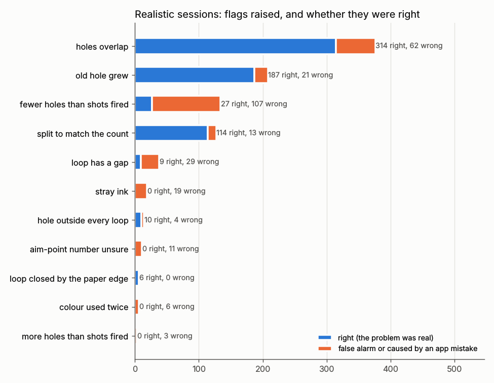
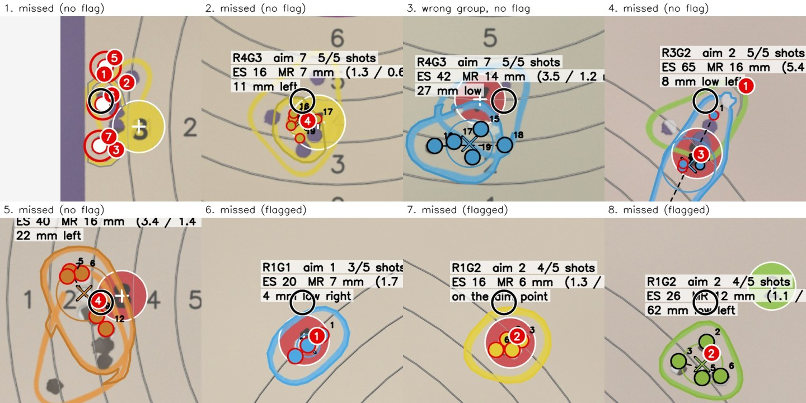

# Phase 4: validation report

**The analysis now meets all four accuracy targets on the realistic test sessions.** Before this phase it met two.

We ran the app's analysis on 26 fake sessions (126 photos) where we know exactly where every shot went, and scored it. Eighteen of them are "realistic": careful phone photos, with tilt, curl, uneven light, mixed backing, flyers, double holes and some .22. Of those, eight push one awkward case on purpose: loops at the paper edge, a new loop over an old one of the same colour, and stickers shot to bits.

| On the realistic sessions | Target | Before | After |
| --- | --- | --- | --- |
| Clean holes found (holes that touch no other hole) | at least 98% | 99.8% | 99.7% |
| False holes (found but not really there), per card | at most 1 | 3.0 | 0.4 |
| Found holes put in the right group | at least 98% | 93.6% | 99.7% |
| Position error: 95% of holes within | 2 mm | 2.0 mm | 1.9 mm |
| Loops read | | 254 of 272 | 287 of 288 |

Aim points: all 144 found, typically 0.5 mm off, every number read right.

## What was fixed

**Loops the app didn't read.** When the app missed a loop, every hole in it ended up "outside every loop". Three kinds of loop were being missed, and all three are now read:

| Loop at the paper edge | New loop over an old one of the same colour | Loop left open |
| --- | --- | --- |
|  |  |  |

- A loop that runs off the paper is closed along the paper edge, and flagged so you check its holes.
- Where a new loop runs along an old loop of the same colour, nothing changes in the photo, so the new loop looked broken. The old ink there now counts as part of the new loop. This matters most for hand-drawn aim points, where the loop colour always matches the aim point.
- A loop left open with a wide gap is closed with a straight line if its ink follows most of its outline, and flagged as having a gap.

**False holes.** Most false holes came from the app "making up" a missing shot: when a group had fewer holes than shots fired, it split a large hole in two. Checking against the truth showed that the made-up hole landed in the wrong place about half the time, because the missing shot was usually hidden inside a different hole that looked single. Now the app only splits a hole when the evidence is strong. Otherwise it says "Found 4 of 5 shots" and points to the likeliest spots, so you decide. That's in line with "never guess silently".

## What still doesn't work well

- **Overlapping holes.** Clean holes are found 99.7% of the time, but a hole that overlaps another is found only about 4 times in 5, and a shot partly through an older hole only about 2 in 3. A shot through a shot-out sticker is the hardest case. The app does flag every short group ("found 4 of 5 shots"); only 5 of 1,417 holes were missed with no flag at all. This is the main reason a tight group can show fewer shots than you fired.
- **Hurried photos** (the "hard" test set: steep angles, poor light, blur) are not good enough: only 90% of clean holes are found, and false holes jump to over 100 per card, mostly specks along the paper edge. The targets don't cover these photos. The app should warn and ask for a retake instead.
- **Some false alarms.** "Loop has a gap" was wrong 29 times, "stray ink" 19 times and "aim-point number unsure" 11 times (the number was right). They cost a tap each, but they don't give wrong numbers.

**The worst remaining failures** (the black-and-white ring marks where the shot really is). Most are a second shot through an earlier hole, often a .22, often on a sticker.

## What I recommend

- **Marking convention: no change needed.** Edge loops and same-colour loops now work, so neither needs to become a rule. "Keep loops 1 cm inside the edge" and "change colour when re-shooting an aim point" can stay as polite requests.
- **Aim for 5-shot groups.** Fewer shots on top of each other means fewer hidden holes. The spec already recommends 5 to 10.
- **Next for the code:** a photo-quality check before analysis (to catch "hurried" photos), and a better reading of shots through older holes. The second one may need the trained hole detector the spec lists for later.

Full numbers: [full-report.md](full-report.md), with every number in `summary_before.json` and `summary_after.json`. To re-run it yourself, see `tools/README.md` ("Validation").
