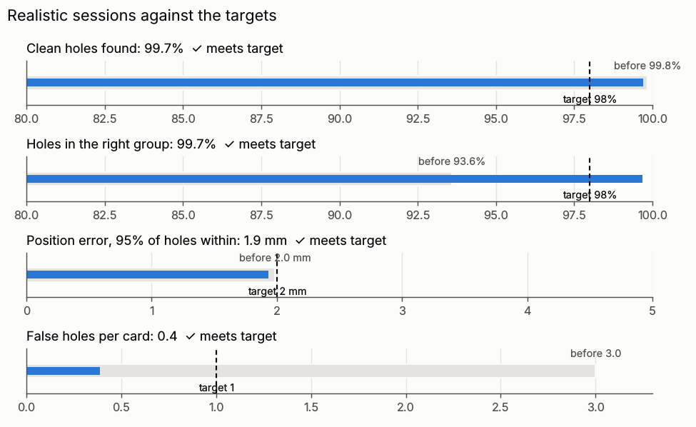
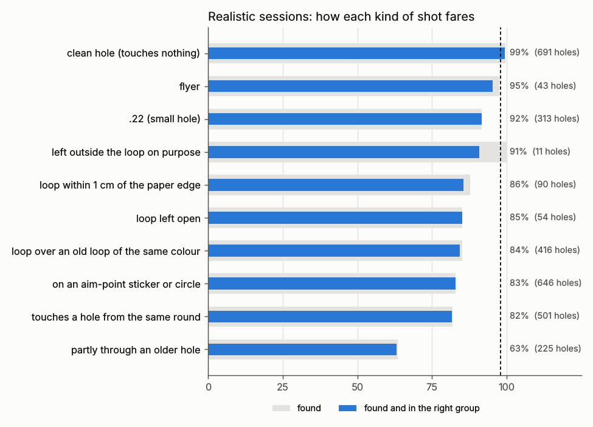
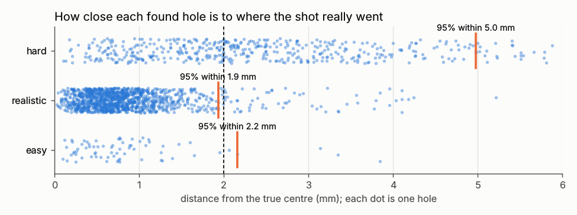
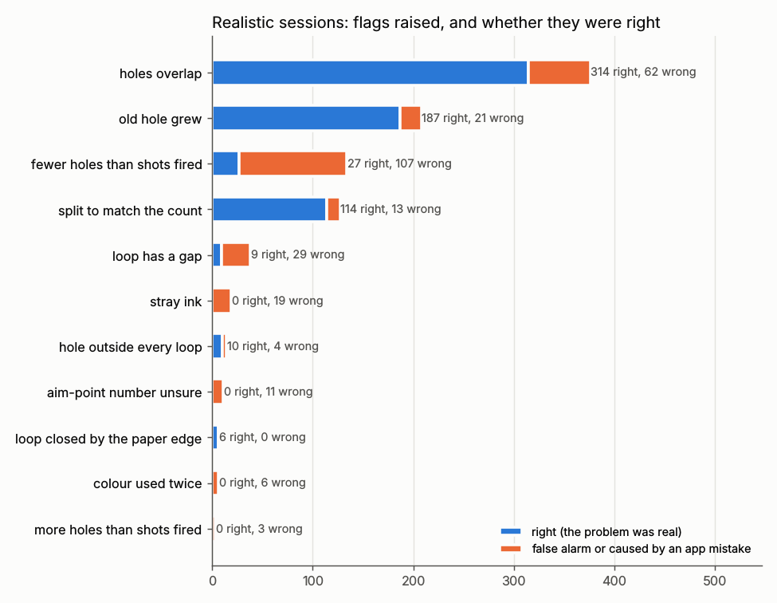
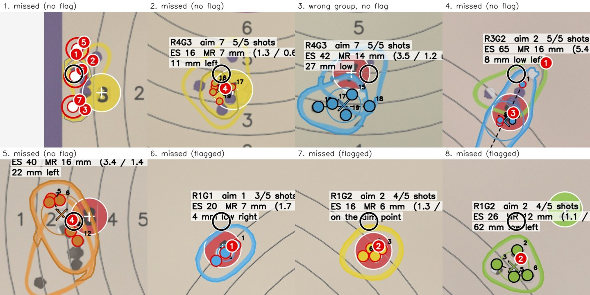

# Validation report (after fixes)

26 synthetic sessions (126 photos) run through `rangetarget session` and compared with the known answers.

**Realistic sessions: 4 of 4 targets met.**

| | easy | realistic | hard |
| --- | --- | --- | --- |
| sessions | 4 | 18 | 4 |
| clean holes found | 100.0% | 99.7% | 90.2% |
| all visible holes found | 59.2% | 87.6% | 78.1% |
| false holes per card | 0.0 | 0.4 | 137.0 |
| position error, typical | 0.7 mm | 0.7 mm | 2.1 mm |
| position error, 95% within | 2.2 mm | 1.9 mm | 5.0 mm |
| ... clean holes only | 1.1 mm | 1.5 mm | 5.1 mm |
| found holes in the right group | 100.0% | 99.7% | 95.6% |
| wrong group with no flag (silent) | 0 | 1 | 1 |
| missed with no flag (silent) | 0 | 5 | 45 |

**Aim points:** easy: 16 of 16 found, typical 0.4 mm off (worst 0.4 mm), numbers right 16 of 16; realistic: 144 of 144 found, typical 0.5 mm off (worst 2.5 mm), numbers right 144 of 144; hard: 30 of 32 found, typical 2.6 mm off (worst 9.6 mm), numbers right 30 of 30

**Loops read** (a loop the app didn't read leaves its whole group unassigned)

| | easy | realistic | hard |
| --- | --- | --- | --- |
| all loops | 24 of 24 | 287 of 288 | 78 of 80 |
| ordinary | 19 of 19 | 181 of 181 | 33 of 33 |
| within 1 cm of the edge | – | 17 of 18 | 13 of 13 |
| over an old loop of the same colour | 5 of 5 | 84 of 85 | 33 of 35 |
| left open | – | 11 of 11 | 14 of 15 |

**Realistic sessions by situation**

| | sessions | clean found | false per card | 95% within | right group |
| --- | --- | --- | --- | --- | --- |
| edge | 4 | 99.3% | 0.0 | 1.9 mm | 99.3% |
| on_sticker | 2 | 100.0% | 0.0 | 2.3 mm | 100.0% |
| plain | 10 | 100.0% | 0.6 | 1.8 mm | 99.7% |
| same_colour | 2 | 99.0% | 0.5 | 2.3 mm | 100.0% |
| aim style: hand_drawn | 7 | 99.6% | 0.3 | 1.8 mm | 99.4% |
| aim style: sticker | 11 | 99.8% | 0.5 | 2.1 mm | 99.9% |

**Worst failures** (easy and realistic; the black-and-white ring marks where the shot really is)

- 1. **missed (no flag)** in `realistic_hand_drawn_edge_s0234` round 4 at (-266, -10) mm: touches a hole from the same round, loop within 1 cm of the paper edge, loop over an old loop of the same colour
- 2. **missed (no flag)** in `realistic_hand_drawn_s0223` round 4 at (-21, -176) mm: partly through an older hole, on an aim-point sticker or circle, .22 (small hole), loop over an old loop of the same colour
- 3. **wrong group, no flag** in `realistic_sticker_s0211` round 4 at (8, -202) mm: flyer, left outside the loop on purpose, loop over an old loop of the same colour
- 4. **missed (no flag)** in `realistic_sticker_s0213` round 3 at (179, 181) mm: partly through an older hole, on an aim-point sticker or circle, .22 (small hole)
- 5. **missed (no flag)** in `realistic_sticker_same_colour_s0242` round 4 at (-194, -28) mm: partly through an older hole, loop over an old loop of the same colour
- 6. **missed (flagged)** in `easy_sticker_s0101` round 1 at (-179, 173) mm: touches a hole from the same round, on an aim-point sticker or circle
- 7. **missed (flagged)** in `easy_sticker_s0101` round 1 at (167, 175) mm: touches a hole from the same round, on an aim-point sticker or circle
- 8. **missed (flagged)** in `realistic_hand_drawn_edge_s0233` round 1 at (193, 177) mm: touches a hole from the same round

Typical time per session on the test computer: 112 s.
