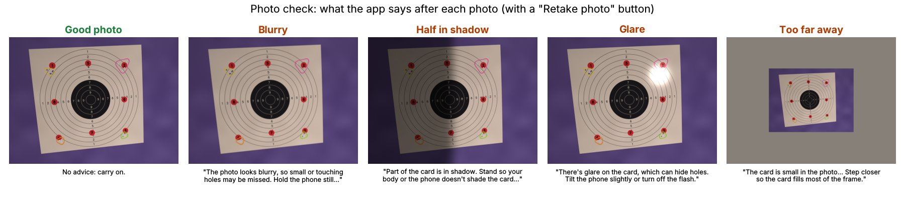

# Photo check

After the card is found in a photo, `PhotoCheck` (core) measures five things and turns each problem into a flag with plain advice. The phone shows the advice with a **Retake photo** button; nothing in the analysis changes. Requirement: `docs/SPEC.md`, App v1, Photo check.

| Measure | How | Limit |
| --- | --- | --- |
| Blur | Median, over 180 directions, of the distance in card mm over which the photo goes from 25% to 75% of the way from the black disc to the paper around it. Directions crossed by holes or ink are skipped. | over 0.6 mm |
| Card too small | Fewest photo pixels per mm anywhere on the card | under 2.9 px/mm |
| Steep angle | Most pixels per mm anywhere on the card ÷ fewest | over 1.45 |
| Shadow | Paper brightness in 40 mm patches: darkest tenth ÷ brightest tenth | under 0.65 |
| Glare | Share of the card burnt out to (almost) white | over 1% |
| Too many holes (app) | New holes found vs shots planned | more than 2 × planned + 5 |

## Where the limits come from

`rangetarget photocheck out/validation/sessions test_data/real` on the Phase 4 validation set (2026-11-24):

| | blur (mm) | least px/mm | angle | even light |
| --- | --- | --- | --- | --- |
| easy (12 photos) | 0.17–0.25 | 3.8–4.0 | 1.04–1.11 | 0.94–0.97 |
| realistic (75 photos) | 0.23–0.48 | 3.1–3.8 | 1.01–1.41 | 0.82–0.95 |
| hard (15 photos) | 0.39–0.83 | 2.7–3.6 | 1.04–1.63 | 0.74–0.87 |
| real photo | 0.23 | 3.5 | 1.06 | 0.74 |

Every easy and realistic photo and the real photo pass; 4 of 15 hard photos are flagged. Glare never occurs in the synthetic set; its limit comes from a unit test (a 90 mm glare patch must be caught).

The hard preset's worst photo (321 false holes) passes all five photo measures: its light changed from the blank card to round 1, so the comparison found changes everywhere. The too-many-holes check catches that case on the phone, where the plan says how many shots were fired.

These limits are a first guess from synthetic photos. Real range photos may need them moved; `rangetarget photocheck <folder>` prints the numbers for any photos.

